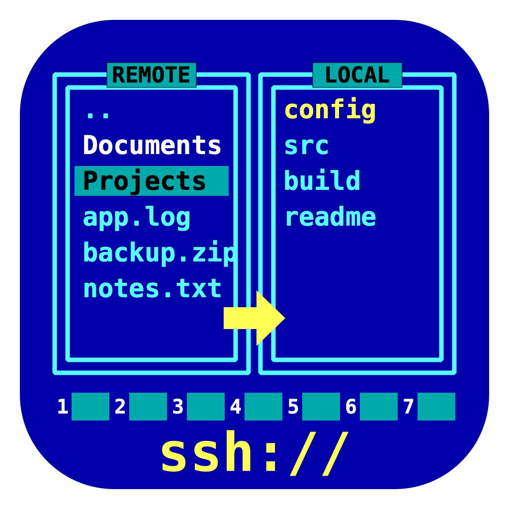

# SSH Browser

<p align="center"></p>

A Finder-style file browser for a remote Mac over SSH/SFTP, with a Norton Commander-inspired icon.

**Why:** browsing a server with Finder/Spotlight makes the remote index and search, which eats memory
you want for server processes. SSH Browser talks plain SFTP: nothing is installed on or left running on the
remote, and there is no indexing. The only commands it ever runs there are `cp -R` (server-side copy) and
`rm -rf` (fast folder delete), each as a single short-lived process.

## Features
- Browse, back/forward/up, path bar, sortable columns (folders first), show/hide dotfiles
- Upload (button or drag from Finder, folders included) and download, in a queue of 3 parallel transfers with progress and cancel
- Open a file (downloads to a temp folder), new folder, rename, delete (confirmed), copy / cut / paste on the remote, on-demand folder size
- Saved hosts: name, host (IP, DNS name or `~/.ssh/config` alias), username, port, optional key file, optional password, start folder
- **Passwordless** sessions: leave key file and password empty and your ssh-agent / default `~/.ssh` keys are used
- Passwords live in the **macOS Keychain**, never in the config file
- Unknown host keys show a fingerprint prompt before being added to `~/.ssh/known_hosts`

## Install to /Applications

Requirements: macOS, [Homebrew](https://brew.sh), Python 3.14 (`brew install python@3.14`).
Python 3.15 is not supported yet because `qasync` does not work on it.

```bash
git clone https://github.com/ilfir/ssh-browser.git
cd ssh-browser
scripts/install.sh
```

That builds `dist/SSH Browser.app` and copies it to `/Applications/SSH Browser.app`. Open it from
Launchpad or Spotlight, or:

```bash
open "/Applications/SSH Browser.app"
```

To build without installing: `scripts/build_app.sh`, then drag `dist/SSH Browser.app` into Applications.
To upgrade, `git pull` and run `scripts/install.sh` again (delete `dist/` first to force a rebuild).

The app is ad-hoc signed. If you copy it to another Mac and macOS says it can't be opened,
right-click it, choose **Open**, then confirm once.

### Remote machine setup
Turn on **System Settings → General → Sharing → Remote Login** on the remote Mac. To read `~/Documents`,
`~/Desktop`, `~/Downloads` or external volumes over SSH, give Full Disk Access to
`/usr/libexec/sshd-keygen-wrapper` (System Settings → Privacy & Security → Full Disk Access).
To stop Spotlight indexing on the remote as well: `sudo mdutil -a -i off`.

### Passwordless login (recommended)
```bash
ssh-keygen -t ed25519            # skip if you already have a key
ssh-copy-id user@remote-host
```
Then add the host in the app and leave key file and password empty.

## Using it
1. Click **Hosts…** → **Add…**, fill in the host, and save.
2. Pick the host in the toolbar and click **Connect**.
3. Double-click folders to enter them; drag files from Finder into the list to upload.

| Shortcut | Action |
|---|---|
| ⌘[ / ⌘] / ⌘↑ | Back / forward / enclosing folder |
| ⌘R | Refresh |
| ⌘U / ⌘D | Upload / download |
| ⌘C / ⌘X / ⌘V | Copy / cut / paste (on the remote) |
| ⌘⇧N | New folder |
| Return | Rename selected |
| ⌘⌫ | Delete |
| ⌘⇧. | Show hidden files |

Config is stored in `~/Library/Application Support/SSHBrowser/hosts.json` (override with `SSHBROWSER_CONFIG_DIR`).

## Develop
```bash
/opt/homebrew/bin/python3.14 -m venv .venv
.venv/bin/pip install -r requirements.txt
.venv/bin/python -m sshbrowser     # run from source
.venv/bin/python -m pytest         # tests use an in-process SFTP server, no real remote needed
.venv/bin/python tools/make_icon.py  # regenerate assets/AppIcon.icns
```

Layout: `sshbrowser/sftp_service.py` (asyncssh SFTP layer), `config.py` (profiles + Keychain),
`main_window.py` (PySide6 UI), `transfers.py` (queue), `hosts_dialog.py`.

## Known limitations
- No drag-out to Finder yet (use Download).
- Opening a file downloads it first; edits are not synced back.
